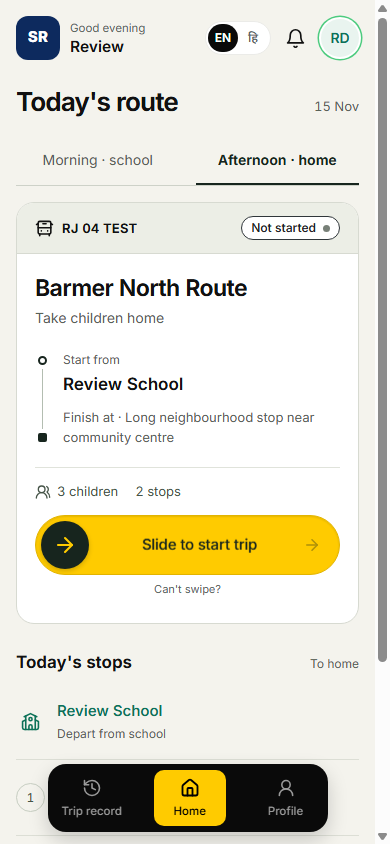
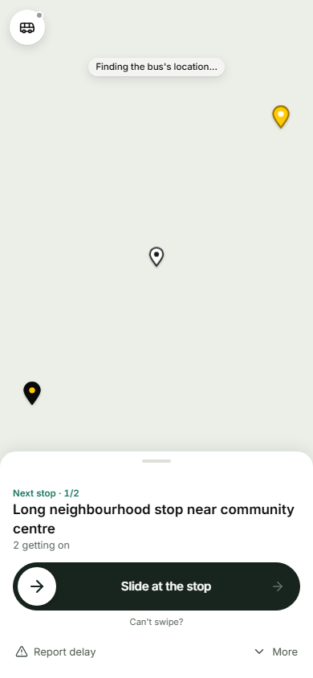
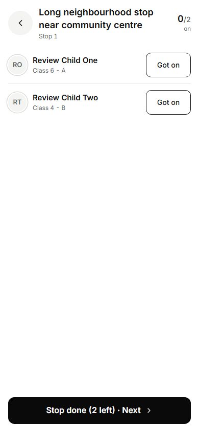
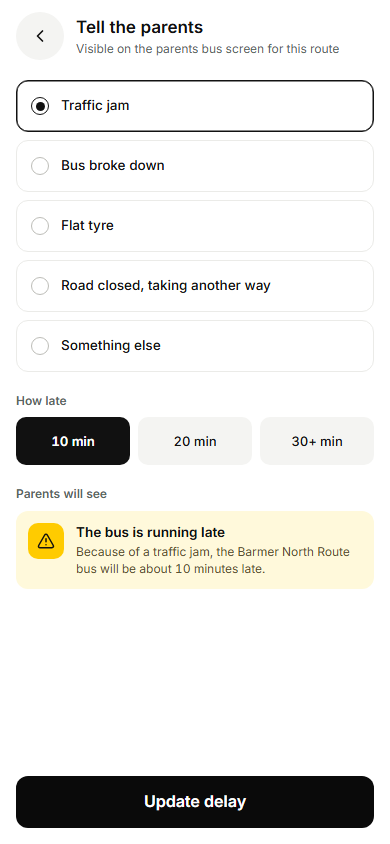
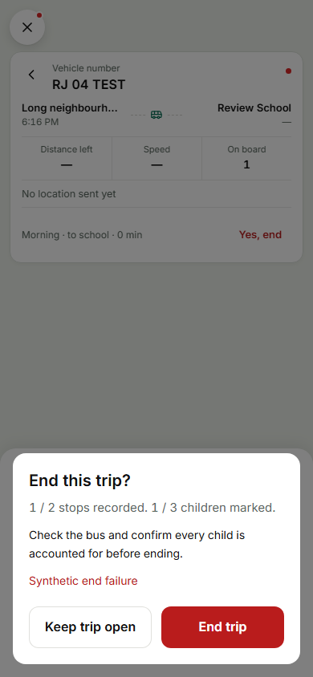
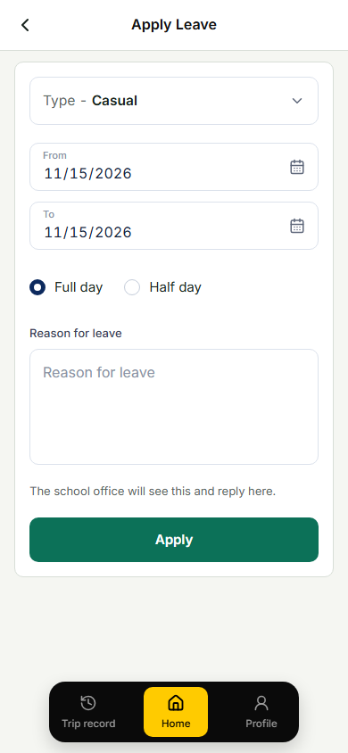

# Driver app: system and interface upgrade

Implemented 15 November 2026 in the staff app checkout, with one backend persistence correction. This work is local and has not been pushed. AI assistant design is untouched.

## Direction and research

The driver interface keeps its existing yellow start action, green status, black working controls and Inter/Noto typography. A warm neutral canvas (#F5F6F2), dark green (#0C7158), readable secondary text (#59665E), fine borders (#D8DED7), 16px gutters and 14px surfaces provide a consistent working environment. Ordinary controls are 48px where practical; primary task controls are 52px. Long stops and child names wrap. Personal salary/leave/attendance pages inherit this vocabulary only inside the driver shell; teacher/ERP identities remain separate.

[Google's interaction principles](https://developers.google.com/cars/design/design-foundations/interaction-principles) informed a short next-stop hierarchy, explicit feedback and recoverable tasks. [Visual principles](https://developers.google.com/cars/design/design-foundations/visual-principles) informed legibility and restraint. This is a phone PWA adaptation, not automotive certification. No vehicle-display dp dimensions were treated as CSS requirements.

[WCAG contrast guidance](https://www.w3.org/WAI/WCAG22/Understanding/contrast-minimum.html) informed darker green and secondary text: the previous white-on-mint action was approximately 2.07:1. [Target size guidance](https://www.w3.org/WAI/WCAG22/Understanding/target-size-minimum.html) informed the review; the preferred 48px controls are a phone usability choice. No blanket accessibility conformance claim is made.

[MDN geolocation documentation](https://developer.mozilla.org/en-US/docs/Web/API/Geolocation/watchPosition) informed permission/error handling and watch cleanup. A received GPS fix and a successfully shared server position are now distinct states.

## Implemented system fixes

- Authoritative identity must load before role-specific shell/header/navigation. `/me` and active `/bus/route` no longer reuse persisted offline cache. Ordinary offline caches remain available.
- Trip is immersive: its own controls occupy the screen. Shared header and bottom navigation previously obscured the stop heading and operational buttons; rendered review found and corrected both overlaps.
- GPS fixes expire after 30 seconds. Permission/error callbacks clear the old position/speed; late callbacks are ignored after cleanup. Position uploads are serialized, and failed delivery has a visible state. Wake-lock promises are released even when resolution arrives after cleanup.
- Stop calibration, child marking and completing a stop share a mutation lock. Child callbacks are awaited. Completing a stop with unmarked children needs a separate explicit confirmation, without silently marking them.
- Persistent trip-end confirmation shows recorded progress and keeps errors/retry visible. Backend `busService.end` propagates a failed database update rather than returning success.
- Delay copy says it updates the parents' bus screen. The current backend does not queue parent push notifications for these writes; the UI no longer promises delivery.
- History only displays records whose date matches the selected date. Route-derived kilometres are explicitly an estimate, not GPS distance travelled.
- Failed logout preserves the session and displays retry feedback. Driver profile no longer sends the user to the excluded AI assistant.
- Stop, delay and proximity dialogs use shared focus/scroll/Escape handling. Busy dialogs cannot dismiss mid-save. Proximity content can scroll on short screens. Automatic alert dismissal never marks a child.

## Page coverage

| Surface | Result |
| --- | --- |
| OTP login / role handoff | Previous ERP flag + cached teacher identity exercised; neutral shell until driver identity |
| Home | Route and vehicle hierarchy, complete stop labels, larger selector, labelled navigation |
| Trip preparation | Deliberate start and route mode; route data requested fresh |
| Running trip | Full-screen map task, readable next stop, visible GPS/sync errors |
| Child roster | Larger actions, wrapped identity, saved state, unfinished-stop confirmation |
| Delay | Readable choices, real bus-screen update copy, dialog handling |
| Trip finish | Persistent confirmation, failure stays active, successful retry returns home |
| Trip history | Date guard and honest route estimate |
| Profile | Driver-scoped visual system, alert preferences, honest logout failure |
| Salary | Shared screen inherits driver tokens; populated payslip rendered |
| Own attendance | Shared calendar inherits driver tokens; populated month rendered; semantic day colours retained |
| Leave / apply | Shared list and form inherit driver tokens; populated request and application rendered |
| Notices | Shared notice reader inherits driver tokens; populated notice rendered |

Shared personal pages use the existing role-authorized APIs; no new role capabilities or invented business data were introduced. See [source audit](system-audit.md) and [trip lifecycle notes](trip-notes.md) for evidence and remaining operational considerations.

## Verification

- `npm test`: 22 passed, zero failed/skipped. Four new regression cases execute the actual staff cache module and backend end method with isolated fixtures.
- Staff TypeScript check and backend build passed; production export checked in a separate temporary staff snapshot so the running dev server was not disturbed.
- [Browser harness](browser.cjs) intercepts every API request in an isolated Chrome context and uses a synthetic blank basemap. [Machine-readable results](browser/result.json) contain 17 captures, zero observed runtime exceptions and no horizontal overflow at captured widths. Home/profile were also captured at 360px; primary flow at 390px.
- Exercised delayed identity, previous ERP-mode OTP login, trip start, fresh GPS followed by permission loss, child mark, unmarked-child confirmation, delay save, failed trip finish, successful finish retry, failed logout and populated personal screens.
- Source/diff checks passed. No live trips, database records, locations or notification sends were created.

Limits: no real outdoor GPS journey, physical-device permission settings, background PWA suspension, actual parent delivery or simultaneous-driver concurrency test. Some recovery paths are source-reviewed rather than fully browser-mocked: stale-fix timing, rapid history response races, no-route/503 identity variants, wake-lock timing, every focus permutation and proximity-alert auto-dismiss. Synthetic tests do not establish driving safety or production telemetry quality.

## Rendered review

All screenshots contain synthetic review identities, not school records.
