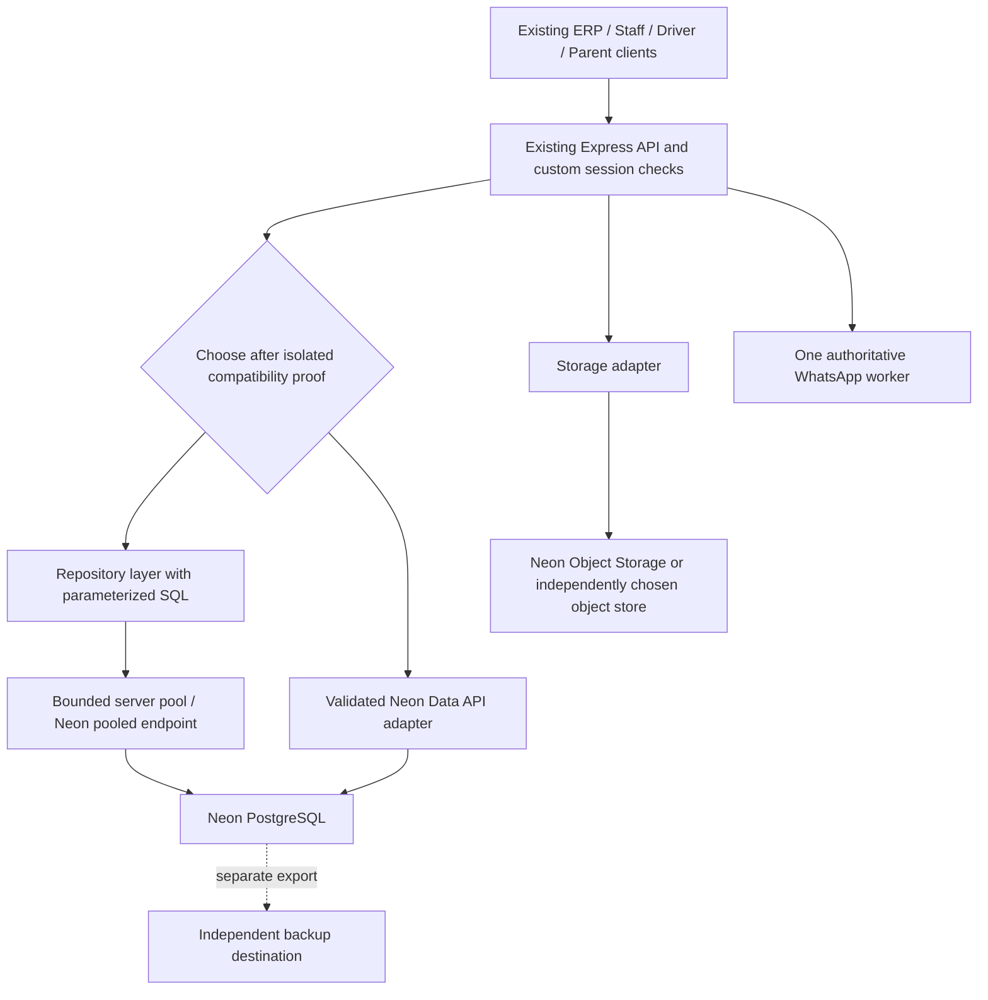

# Migration feasibility and acceptance plan — no execution

This is a proposed engineering plan, not a ready-to-run production migration. No new Neon project, driver, SDK, credentials, SQL migration or application adapter was installed or deployed.

## Source boundary

Reviewed backend working tree: `F:/folders of web/sms backend`, base `48d826f`, including its existing tracked edits. Read-only fetch additionally inspected `origin/main` at `7b35969`; local backend is three commits behind that ref. No merge was performed. Remote homework submission changes add `public.homework_submissions`, its composite key, JSON files and Parent/Teacher query paths. These must be reconciled with local changes before estimating or implementing migration. Remote HEAD is not proof of what is deployed.

The local scanner's 473 literal `.from()` sites exclude variable-name queries such as dashboard pagination and WhatsApp auth-state access. Its 53 relation names exclude the new remote homework table. The 35 SQL-file count includes schema/setup/seed material. Neither SQL declarations nor source calls certify the live schema.

## Proposed architecture options



Preference for a long-lived Express process: evaluate a small process-wide `pg` pool for direct SQL; alternatively evaluate the documented serverless driver where runtime needs justify it. This review does not select/install a package version. Use one checked-out connection for an entire SQL transaction. A pool's generic `.query()` calls are not automatically one transaction. Never expose a connection URL to browser bundles.

Connection-method considerations come from [Neon connection guidance](https://neon.com/docs/connect/choose-connection); pooled vs direct operational details from [connection pooling](https://neon.com/docs/connect/connection-pooling). A transaction-mode pool does not preserve arbitrary session state. Source-derived recommendation: schema-qualify financial tables and keep request identity transaction-local if using database RLS.

## Stage 0 — measured baseline, no migration

Obtain, through an authorized admin-only review:

- Current Supabase project plan, invoice, region, PostgreSQL version and extensions; actual deployed backend revision/host plan/region.
- Actual schema, table sizes, RLS/grants, SQL functions/owners/search paths, triggers, unique constraints, generated columns and sequence state.
- Active students/staff/parents, API concurrency and request mix; do not size solely from registered users.
- Warm/cold request timings; database awake time, CPU/memory pressure and slow-query samples.
- File manifest per bucket: key, size, content type, public/private policy, DB references and orphan candidates.
- Number of live bus routes, GPS writes, simultaneous chat views and WhatsApp connected hours.
- A tested backup with database and files, and a recovery time/recovery point objective chosen by the school.

Illustrative read-only discovery queries for a later authorized connection; **not run here**:

```sql
SELECT version();
SELECT pg_size_pretty(pg_database_size(current_database()));
SELECT extname, extversion FROM pg_extension ORDER BY extname;
SELECT schemaname, relname, n_live_tup AS estimated_rows
FROM pg_stat_user_tables ORDER BY schemaname, relname;
SELECT schemaname, tablename, policyname, roles, cmd, qual, with_check
FROM pg_policies ORDER BY schemaname, tablename, policyname;
```

`n_live_tup` is approximate; use exact counts during reconciliation. Do not run heavy counts/checksums on production indiscriminately. Existing RLS policy text and backups can contain sensitive identifiers; restrict artifact access.

## Stage 1 — isolated feasibility proof

Use synthetic records or a sanitized branch. Do not boot a production-configured Express/WhatsApp worker against a copied database: `whatsapp_auth` and outbox state may reconnect a real device. The initial proof should use a narrowly scoped harness with outbound notifications disabled/blocked; no existing disable flag is assumed.

Compare two candidates against identical expected JSON outputs:

| Case | Existing contract to preserve | Failure to catch |
|---|---|---|
| Student list | Filters, stable ordering, pagination, nullable fields | Missing/duplicate rows across pages |
| Nested relations | Student/class/section; wallet/receipt links | Different joins or foreign-key inference |
| Login lookup | `.or()` across accepted identifiers, max two matches | Ambiguous account accepted |
| Count/head | Exact count without row body | Count silently absent or estimate substituted |
| Single/maybeSingle | Missing row vs invalid duplicate row | 404/empty/success confused |
| Upsert | Composite conflict targets for marks/submissions | Updates become duplicate inserts |
| JSON/arrays | Homework `{url,name,kind}` and nested documents | Serialization loss or reordered meaning |
| Money values | Precise decimal/whole-rupee contracts | `NUMERIC` strings concatenate or round wrongly |
| Dates/timestamps | DATE string vs timestamp, IST boundaries | Attendance/payment moves to another day |
| RPC | Scalar, JSON and void responses; named parameters | Client treats success as missing data |
| Error handling | Missing-table setup, duplicate key, permissions | Existing `PGRST...` branches stop working |

Neon documents PostgREST compatibility, but not the whole Supabase SDK bundle as an unconditional substitute. Treat `.from()` reuse as a hypothesis to validate against the above cases. A successful SELECT alone is not acceptance of inserts, RPC, auth or Storage. [Data API](https://neon.com/docs/data-api/overview)

For the REST option, explicitly design server access, token validation, role grants and RLS. Existing Supabase service-role credentials do not carry across. Do not use the application's `role: admin` token claim as an unreviewed privileged database role. A custom JWKS/token bridge, if chosen, is additional implementation and key-rotation work. [Custom Data API authentication](https://neon.com/docs/data-api/custom-authentication-providers)

**Gate:** choose A/direct SQL or B/Data API only after recording which existing calls work unchanged, which need adapters and which require replacement. No reliable project-duration quote is possible before this exercise.

## Stage 2 — schema and query migration rehearsal

Use the deployed schema as authority; the repository's historic SQL files are a starting point, not a substitute for a catalog export. `setup_all.sql`, base schema, migrations and seeds overlap; do not run them all blindly.

Portable candidates: application tables, UUIDs, foreign keys, JSONB, indexes, PostgreSQL functions and generated balances. The local schema requests `uuid-ossp`; it is listed in Neon's supported extensions, but the actual source version and all installed extensions must be verified. [Extensions](https://neon.com/docs/extensions/pg-extensions)

Resolve these before restore:

1. Source/target PostgreSQL and export-client compatibility; inspect [compatibility notes](https://neon.com/docs/reference/compatibility).
2. Supabase-managed `auth`, `storage`, platform-specific publications and roles: do not copy as if they recreate managed services.
3. Application references to `anon`, `authenticated` and `service_role`; replace with reviewed target roles/grants.
4. Function ownership, `SECURITY DEFINER`, `search_path`, execute grants and table privileges.
5. Sequence values and unique numbering for fees, certificates and gate passes.
6. Existing RLS-enabled tables with no user policy: an ordinary new runtime role can suddenly see no rows. Decide explicit grants/RLS rather than bypassing everything to make tests pass.
7. Backend errors matched by Supabase-specific code/message: update mapping while preserving public API behavior.

Authentication continuity requirements: original UUIDs, password hashes, Parent/Staff account matching, account-disable checks, SESSION_SECRET and cookie routing behavior. Preserve existing login first. A later migration to Managed Better Auth would require its own enrollment/session/role design.

## Stage 3 — storage rehearsal

Write a provider-neutral storage boundary only after selecting a target: upload, read/public URL, presign, delete and object identity. Keep provider-specific URL parsing inside that boundary.

Required steps:

1. Enumerate live buckets and referenced object keys, including photos, private admission documents, homework, new Parent submissions and any institution image/QR URLs pointing to Supabase. A sample SQL schema is not the object inventory.
2. Copy objects with original bytes, MIME metadata and intended access level. Store a manifest with strong content hashes; multipart ETag is not a universal content checksum.
3. Update relational and JSON references with a reversible old→new mapping. Include `homework.files`, `homework_submissions.files`, photo URLs, `students.document_files` paths and any settings values found in the live scan.
4. Change `cleanFiles`, public-prefix validation and photo deletion's `pathOf` logic. Otherwise existing links may be rejected or the wrong provider's object may be deleted.
5. During transition, accept only explicitly allowed legacy and new origins, not arbitrary URLs. Avoid turning a migration workaround into an SSRF/arbitrary-file allowance.
6. Private document URLs remain short-lived and available only after office authorization. Verify unauthorized Parent/Staff requests cannot fetch them.
7. Test PDF range loading, mobile open/download, long Hindi names, expired signed links, browser CORS and failed upload cleanup.
8. Preserve old objects until the validation/retention window ends. Never delete a shared object solely because one of several references was changed.

Neon has a current S3-style service; evaluate it against actual required operations. Its documented lifecycle/versioning enforcement limitations mean that an independent file backup and explicit orphan-cleanup policy need consideration. [S3 compatibility](https://neon.com/docs/storage/s3-compatibility)

## Stage 4 — financial and permissions acceptance

Money test cases on synthetic data:

- Two simultaneous collections for the same student; unique receipt numbering; no ledger lost update.
- Client timeout after server commit; retry must not charge or record a receipt twice.
- Receipt insertion fails; ledger update fails; compensation fails; distinguish unknown outcome from known failure.
- Cancel a receipt twice/concurrently; refund more than the refundable amount; wallet spending from two requests.
- Discounts, fines and waived fine reasons; partial payments; cash/UPI/cheque state; carry-forward balances.
- Existing exam/marks/payroll amount mapping, audit log attribution and statement exports.
- Certificate/gate-pass counters and identity references after sequence restore.

If direct SQL is chosen, evaluate a single transaction for multi-table collection instead of reproducing cross-request compensation. This changes implementation semantics and must be separately approved/tested as part of the later migration; it is not applied now. An idempotency key is a design candidate, not something already present or guaranteed by Neon.

Permission cases:

- Parent A cannot select/upload/submit for Parent B's child, even using a manually changed ID.
- Teacher outside a section cannot read or mark its homework/attendance.
- Driver can update only the permitted route/trip.
- Account disabled/Staff relieved/role changed retains the current sign-out behavior.
- Office-only admission scans and financial records remain office-only.
- API and any exposed Data API reject anonymous data access; pooled requests do not inherit another user's context.

**Gate:** all monetary reconciliation totals exactly agree; no authorization regression; unchanged public response semantics or explicit versioned change.

## Stage 5 — performance and cost verification

Exercise realistic opening-time attendance, fee collections, report-card generation, background WhatsApp checks, GPS traffic and concurrent parent chats. Measure end-to-end API p50/p95, not just a trivial database SELECT. Record awake hours and actual CU usage; retain the same response-size/SQL/index assumptions when comparing providers.

Source-specific cost observations:

- Connected WhatsApp worker checks the outbox each minute outside quiet hours (7 AM–9 PM IST). That can prevent a five-minute idle window even with no pending messages.
- Driver location changes add writes/history; chat and visible parent bus screens add repeated reads.
- Dashboard uses a cache but also paginated bulk reads, so query tuning may matter more than provider substitution.
- `/api/health` does not need the DB. Keep database-dependent readiness/diagnostic checks from accidentally becoming an always-on billing driver.
- Render YAML says `plan: free`; it does not prove the deployed plan. Do not claim Neon fixes the API host's sleep or the WhatsApp socket's uptime requirements.

## Stage 6 — cutover design

Choose one approach based on measured size and acceptable downtime:

**Maintenance-window dump/restore:** simplest operational model for modest datasets. Freeze all writers, drain/pause integrations, export a consistent snapshot, import/validate, switch the reviewed server configuration, resume one writer environment. Downtime must be measured in rehearsal; no minutes/hours are promised here. [Official migration guide](https://neon.com/docs/import/migrate-from-supabase)

**Logical replication:** initial copy + replication lag monitoring, then a short final freeze/catch-up/switch. It can reduce table-data downtime, but adds replication slots/WAL retention, network permissions and operational burden. DDL, sequence synchronization, large-object/file handling and writer roles require explicit treatment; do not assume automatic replication of every platform feature. [Official replication guide](https://neon.com/docs/guides/logical-replication-supabase-to-neon)

For either approach:

1. Publish a maintenance/read-only state across office, Staff, Driver and Parents. Offline client retries must not continue writing to the old database after a switch.
2. Stop scheduled/batch workers and avoid starting a second WhatsApp socket. Record which outbox items were actually sent.
3. Capture final database snapshot, sequence state and file delta/manifest.
4. Validate counts, constraints, dates, balances, receipt IDs, hashes and selected complete workflows.
5. Switch the backend as one controlled unit; avoid random old/new database selection per request.
6. Clear relevant backend caches; reload clients coherently. Preserve existing API paths/cookies unless a reviewed change is required.
7. Re-enable only one authoritative writer/worker environment, then perform controlled accepted test writes and monitoring.
8. Keep the former source protected from writes and retain backups until the acceptance period is over.

## Rollback decision table

| State | Correct response |
|---|---|
| Proof/rehearsal only | Discard the test environment; production remains unchanged |
| Final freeze, no new Neon writes | Old source can resume after confirming it is still current |
| Neon accepted new writes | Freeze again, export/reconcile the delta, preserve financial/outbox/file outcomes; do not simply point back |
| Notification sent externally | Record/reconcile it; a DB rollback cannot unsend it |
| Private object deleted/changed | Recover from validated object backup/retained source, not just DB history |
| Read traffic split or stale caches | Restore a single authority and invalidate caches before resuming writes |

A database point-in-time restore is not a distributed transaction rollback. Restoring a whole database to fix one record can discard unrelated valid school transactions; prefer targeted repair where appropriate and reviewed.

## Final go/no-go checklist

- [ ] Live baseline and bill known; enough savings or operational benefit to justify one-time migration effort.
- [ ] All local/cloud backend changes reconciled; exact migration revision pinned.
- [ ] SDK/API route selected from representative proof, not marketing compatibility alone.
- [ ] No broken or silently hidden legacy homework files; new Parent submissions included.
- [ ] Private documents remain private; no new public database credential path.
- [ ] Money correctness, concurrency, login and per-child/per-section permissions pass.
- [ ] Production-like timing and background-worker cost are acceptable.
- [ ] Database and object restore drills pass; external-message reconciliation is understood.
- [ ] Final write freeze, routing, source authority and post-write rollback responsibilities are assigned.
- [ ] Measured results, recovery targets and actual usage are reviewed before any provider is removed.

Until these are demonstrated, the verdict is **feasible candidate, not production migration ready**.
