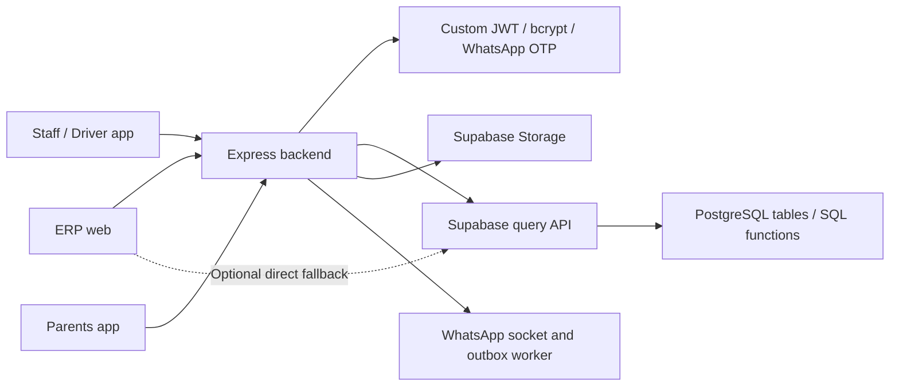

# Neon का वास्तविक review — SMS Barmer ERP

**तारीख: 16 November 2026 · केवल review, कोई replacement नहीं।**

**निष्कर्ष:** Neon हमारे database का उपयुक्त candidate है। लेकिन अभी सिर्फ सस्ता monthly bill सुनकर Supabase हटाना सही निर्णय नहीं होगा। हमारे लिए सबसे बड़ी जाँच PostgreSQL compatibility से आगे है: existing query API, financial transactions, WhatsApp worker, पुराने upload links और permission boundaries। पहले एक अलग test environment में इनका proof चाहिए।

[Migration और rollback का technical plan](MIGRATION.md) · [खर्च का interactive calculator](cost-model.html) · [Source inventory](source-inventory.json) · [Official references](SOURCES.md)

## 1. इस review में वास्तव में क्या देखा

Backend का `src/`, SQL schema/migrations, web की database services, Staff और Parents के API/polling paths देखे। Local backend commit `48d826f` है और उसमें पहले से uncommitted changes हैं; उन्हें बदला नहीं। GitHub fetch में backend `origin/main` पर `7b35969` मिला। उसके तीन अतिरिक्त commits का diff भी पढ़ा, खासकर नया `homework_submissions` feature। Backend को merge नहीं किया। यह production deployment का audit नहीं है।

Static inventory के local-backend snapshot में:

| माप | परिणाम | इसका सही मतलब |
|---|---:|---|
| Supabase का उल्लेख करने वाली backend TypeScript files | 60 | हर file एक अलग feature या migration task नहीं है |
| Literal `.from("...")` call sites | 473 | Source locations; actual requests/day नहीं। Variable table names शामिल नहीं |
| उन calls में literal relation names | 53 | Live database की table count नहीं |
| Literal RPC function names | 8 | इनके अलावा SQL definitions और dynamic calls भी verify करने होंगे |
| Backend में मिले SQL files | 35 | Schema/setup files सहित; सभी deployed हैं, ऐसा नहीं माना |

Counts reproducible हैं: `node docs/neon-review-2026-11-16/inventory.cjs`। New remote homework migration और table इन local counts के अतिरिक्त हैं। Browser timers में map redraw/animation भी हो सकते हैं; हर `setInterval` को database traffic नहीं गिना गया।

**क्या नहीं देखा:** Supabase का actual invoice, current plan, live row counts/schema/extensions, stored files का volume, Render का actual region/plan, peak traffic और latency। इसलिए exact बचत, migration downtime या production performance का पक्का दावा नहीं है। `.env` secrets नहीं पढ़े।

## 2. Neon कैसे काम करता है

इसे ऐसे समझें: PostgreSQL query चलाने वाला CPU/RAM और durable database storage अलग हैं। Compute बंद होने पर stored records मिटते नहीं। नया request आने पर compute फिर शुरू हो सकता है। WAL यानी database change log durable layer में जाता है। हमारे joins, constraints, indexes और SQL transactions के लिए मूल PostgreSQL semantics रहते हैं। [Architecture](https://neon.com/docs/introduction/architecture-overview)

तीन सुविधाएँ अलग काम करती हैं:

- **Scale to zero:** inactivity पर compute सोता है; storage फिर भी मौजूद और billable हो सकता है। Default inactivity अवधि पाँच मिनट है। Resume में provider सामान्यतः कुछ सौ milliseconds बताता है; हमारे API का कुल response time इससे ज्यादा हो सकता है। [Scale to zero](https://neon.com/docs/introduction/scale-to-zero)
- **Autoscaling:** load बढ़ने पर configured range में CPU/RAM बढ़ता है। यह खराब queries को मुफ्त या तेज बनाने की गारंटी नहीं है। [Autoscaling](https://neon.com/docs/introduction/autoscaling)
- **Branching:** database की अलग copy-on-write state मिलती है। Branch Git branch जैसी development सुविधा है, पर उसके data changes का automatic Git-style merge समझना गलत होगा। हमारे fee changes की rehearsal के लिए उपयोगी है। [Branching](https://neon.com/docs/introduction/branching)

Neon खुद हमारे मौजूदा Express backend, WhatsApp linked-device connection या frontend deployment को अपने-आप replace नहीं करेगा।

## 3. हमारा अभी का system

Web की `studentService.ts` और `feeService.ts` में remote backend preferred path है, लेकिन optional direct Supabase fallback भी है। सिर्फ backend बदलकर पुराने fallback और Supabase health/setup screens छोड़ देना अधूरा migration होगा। Staff/Parents मुख्यतः हमारे API contracts पर निर्भर हैं, इसलिए database swap के लिए उनका पूरा UI दोबारा बनाना आवश्यक नहीं है।

## 4. Feature-by-feature replacement

| हमारा हिस्सा | Neon पर स्थिति | काम / निर्णय |
|---|---|---|
| Students, fees, attendance, marks, payroll | PostgreSQL के कारण अच्छी संभावना | Actual schema + data restore और contract verification |
| Office password login | हमारा bcrypt/JWT पहले से है | Hashes, users, IDs और session secret रखकर query layer बदल सकती है |
| Parent/Staff WhatsApp OTP | हमारा custom backend flow | Neon Auth आवश्यक नहीं; OTP/account tables और WhatsApp state migrate हों |
| Photo/PDF uploads | Neon Object Storage उपलब्ध है | Supabase Storage SDK/URLs की compatibility नहीं मान सकते |
| Private admission scans | Presigned access का विकल्प है | Current authorization और expiry सुरक्षित रखनी होगी |
| Bus/chat updates | अभी HTTP polling paths मिले | Database migration के साथ realtime rewrite जोड़ना जरूरी नहीं |
| SQL numbering / money functions | PostgreSQL functions पोर्ट हो सकती हैं | Roles, grants, ownership, sequences और atomicity test हों |
| Backups | Built-in history + PostgreSQL exports | Files और external side effects की अलग recovery चाहिए |
| REST query SDK | PostgREST-compatible Data API उपलब्ध | कम rewrite का candidate; actual SDK/auth/permission PoC जरूरी |
| Express + Baileys worker | अलग host अभी भी चाहिए | Neon लेने से Render/server का खर्च समाप्त नहीं होता |

Neon के वर्तमान docs में Auth, Data API, Object Storage और Realtime भी हैं। इसलिए “Neon केवल database है, files के लिए हमेशा दूसरा provider चाहिए” अब पूरा विवरण नहीं है। उपलब्धता और maturity हर product के लिए अलग verify करनी होगी। [Current product overview](https://neon.com/docs/get-started/why-neon)

## 5. Query layer बदलने के तीन रास्ते

### A. Backend से सीधे PostgreSQL — मेरी architecture preference

Express routes और response JSON बने रहें; service/repository layer में parameterized SQL या उपयुक्त ORM आए। Database credential केवल server पर रहे। इस रास्ते में Neon Auth/Data API अपनाना जरूरी नहीं।

**फायदा:** financial operations में स्पष्ट transactions, कम provider-specific coupling, SQL tuning और बाद में दूसरे PostgreSQL host पर जाना आसान।

**नुकसान:** 473 literal source sites समेत व्यापक review और conversion है। Dynamic queries अतिरिक्त हैं। `.single()`, `.maybeSingle()`, nested joins, exact counts, pagination और upserts की semantics को mechanical search/replace से सुरक्षित नहीं बदला जा सकता।

### B. Neon Data API से existing query style का reuse

Current docs Data API को PostgREST-compatible बताते हैं और Neon SDKs उपलब्ध हैं। इसलिए पहले कहा गया “हर query को SQL में rewrite करना होगा” अत्यधिक निश्चित था। बहुत-सी query expressions को adapter के जरिए reuse करने की संभावना है। लेकिन actual `@supabase/supabase-js` client को नया URL देकर सभी services चल जाएँगी, यह सिद्ध नहीं हुआ। [Data API](https://neon.com/docs/data-api/overview)

यह रास्ता चुनने से पहले representative tests चाहिए: nested student joins, `.or()` login lookup, count/head, composite-key upsert, missing-row behavior, RPC scalar/void results और error codes। मौजूदा Supabase service-role key Neon credential नहीं है। Storage और Auth API namespaces भी query compatibility से replace नहीं होते।

हमारे JWT अभी secret से HMAC-signed हैं और `role` में application roles जैसे `admin`/`parent` होते हैं। Neon custom Data API auth में documented JWKS validation और database-role mapping है। Existing cookie को सीधे Data API bearer credential मान लेना गलत होगा। Backend-only access strategy या अलग token bridge का design चाहिए। User का application role और Postgres execution role अलग रखें। [Custom authentication](https://neon.com/docs/data-api/custom-authentication-providers)

### C. Neon PostgreSQL + अपना PostgREST server

Query syntax बनाए रखने का एक और architecture option है, लेकिन तब एक अतिरिक्त service, उसकी JWT configuration, upgrades, network और availability भी हमारी जिम्मेदारी होंगे। यह इस review में provision या test नहीं हुआ। सिर्फ database bill घटाने के लिए एक और हमेशा चालू service जोड़ना कुल खर्च बचाएगा, ऐसा नहीं माना जा सकता।

**निर्णय:** Long-term साफ architecture के लिए A अच्छा है। Migration effort कम करने के लिए पहले B का isolated compatibility spike करें। वह spike सफल होने से पहले A का पूरा rewrite शुरू करना और B को बिना test production में लगाना—दोनों अनुचित shortcuts होंगे।

## 6. Authentication: सबसे कम समझा गया हिस्सा

हमारा `authService.ts` `users.password_hash` को bcrypt से verify करता है। `session.ts` अपनी httpOnly cookie sign करता है। Parent accounts, Staff accounts और role checks हमारे backend में हैं। यह Supabase Auth user/session system नहीं है।

इसलिए DB-only migration में passwords reset कराना जरूरी नहीं होना चाहिए: hashes और identifiers अक्षरशः migrate करें। Existing sessions चल सकती हैं **यदि** वही account IDs, signing secret, cookie/domain behavior और authorization rules बने रहें। यह acceptance test होगा, guarantee नहीं। Active/relieved account checks भी migrate हों।

Neon Managed Better Auth एक अलग managed authentication option है; उसकी user/session schema हमारी current schema के बराबर नहीं है। उसे साथ जोड़ना अलग auth migration होगा। [Managed Better Auth](https://neon.com/docs/auth/overview)

Neon का Phone Number plugin OTP flow देता है, लेकिन SMS delivery हमें provider/webhook से करनी होती है। हमारे WhatsApp delivery और existing school account matching का automatic replacement नहीं है। अभी DB migration के साथ auth rewrite जोड़ने का स्पष्ट business benefit नहीं दिखा। [Phone Number plugin](https://neon.com/docs/auth/guides/plugins/phone-number)

## 7. PDF, photos और पुराने links

यह migration की अलग workstream है; database dump file के bytes नहीं ले जाता।

| Storage इस्तेमाल | Source में मिला व्यवहार | Migration requirement |
|---|---|---|
| `student-photos` / `staff-photos` | Public image URLs और Supabase URL से old object path निकालना | Object copy, DB URL mapping, old-path cleanup logic |
| `student-documents` | Private scans, DB में paths, office authorization के बाद 30-minute signed links | Private access, equivalent expiry और sign/download tests |
| `homework-files` | Public photos/PDF, JSON में `{url,name,kind}`, अधिकतम 5 files | Teacher files और Parent submissions दोनों में URL rewrite |
| `attachments` | SQL setup में public bucket declaration | वास्तव में कौन-सी files/use paths deployed हैं, अलग सूची चाहिए |

विशेष खतरा: `homeworkFileService.cleanFiles()` केवल current Supabase bucket prefix वाले URLs स्वीकार करता है। सिर्फ नया uploader जोड़ देने पर **पुरानी attachments response से गायब** हो सकती हैं, जबकि files पुराने bucket में मौजूद हों। Migration में old/new mapping या temporary dual-provider reader आवश्यक होगा। Parent की नई `homework_submissions.files` JSON भी शामिल हो; उसे छोड़ना अभी बनाए feature को तोड़ देगा।

Neon Object Storage S3-style है और branches के साथ file state fork करता है। यह हमारे लिए consolidated provider का रास्ता है। [Object Storage](https://neon.com/docs/storage/overview)

लेकिन इसकी S3 compatibility पूर्ण AWS S3 नहीं है: वर्तमान docs में lifecycle rules और versioning configurations के enforcement की सीमाएँ हैं; replication/कुछ policy operations अनुपलब्ध हैं। Upload/download/delete, signed URLs, CORS, PDF range requests और restore behavior की rehearsal करें। Private documents के backups के लिए versioning/lifecycle पर बिना जाँच निर्भर न हों। [S3 limitations](https://neon.com/docs/storage/s3-compatibility)

यदि independent long-term file backup चाहिए तो mature external object storage भी एक option है। अभी provider चुना नहीं गया और न कोई bucket बनाई गई है। Data और files एक platform में होने से हर recovery case अपने-आप atomic नहीं माना जा सकता।

## 8. Money functions: सबसे ज्यादा risk वाला migration

आठ literal RPC names मिले: `next_fee_receipt_no`, `apply_fee_payment`, `increment_paid_fee`, `cancel_fee_receipt`, `add_wallet_entry`, `refund_fee_paid`, `next_certificate_no`, `next_gate_pass_no`।

ये सिर्फ helper names नहीं: receipt numbering, ledger increments, refunds और wallet correctness इनके साथ जुड़ी है। `cancel_fee_receipt` में row locking है; wallet/refund migration में `service_role` को function grants हैं। Neon में functions restore करने के साथ equivalent roles/grants/owners भी तय करने होंगे।

Current fee service पहले receipt insert करती है, फिर ledger RPC चलाती है; failure पर receipt delete करने की compensation है। ये अलग API calls हैं—पूरे flow को एक database transaction समझना गलत होगा। Direct SQL route में इसे एक transaction में मजबूत करने का अवसर है, लेकिन वह अलग behavior change होगा जिसे money-specific tests के साथ करना होगा।

**Go-live blockers:** duplicate submit, concurrent cashier, partial timeout, double cancellation, refund limits, wallet double spend, unique receipt/certificate numbering, generated balance और existing audit trail। Migration के लिए accepted mismatch: **₹0**। कोई फर्क आने पर launch रोकें।

## 9. Realtime, Driver और WhatsApp

Parent bus में 10-second polling, teacher chat में 3-second polling और ERP fleet panel में 15-second refresh मिला। Driver location sender का 10-second interval है। ये refresh constants actual DB requests की गारंटी नहीं—visibility, active trip और other guards लागू हैं। Local time redraw को network polling से अलग रखा गया।

Neon Realtime उपलब्ध है और current pricing में beta label है। इसे बाद में evaluate कर सकते हैं; bus correctness को database migration के साथ नए subscription model पर निर्भर करना आवश्यक नहीं। Sealed/authorized queries का model भी हमारे HTTP endpoints का सीधा substitute नहीं है। [Realtime](https://neon.com/docs/realtime/overview)

WhatsApp में linked-device credentials/keys `whatsapp_auth` में persistent हैं और outbox `whatsapp_outbox` से चलता है। इन tables और serialization को migrate किए बिना OTP/alerts बंद पड़ सकते हैं। पुराने और नए environments से एक साथ असली WhatsApp worker न चलाएँ: duplicate messages और device-session conflicts हो सकते हैं।

**खर्च का खास बिंदु:** `setInterval(kick, 60_000)` connected WhatsApp में **7 AM–9 PM IST की daytime window** में queue check कर सकता है। Pending messages न हों तब भी lookup हो सकता है। अगर backend/socket जीवित हैं, ऐसे minute queries पाँच-minute inactivity window नहीं बनने देंगे। इस condition में सिर्फ office के manually खुले रहने के घंटों से bill estimate करना गलत होगा। Actual production worker uptime अभी unknown है।

Health routes भी अलग हैं: `/api/health` DB नहीं पढ़ता; `/api/health/supabase` पढ़ता है। Monitoring को DB check पर हर minute लगाने से sleep की बचत घट सकती है। Baileys socket और worker के लिए process hosting अभी भी चाहिए; Neon Functions को उनका proven replacement नहीं कहा जा रहा।

## 10. Performance: फायदा और नुकसान दोनों

**फायदे:** SQL joins/aggregations backend से efficiently चल सकते हैं; suitable indexes और tuned connections से repeated REST round trips घट सकते हैं। Autoscaling exam/result और fee-counter peaks में उपयोगी हो सकता है।

**सीमाएँ:** cold resume, cold cache, API-server wakeup और network latency अलग हैं। Database cold-start की advertised duration को हमारे Home screen load time के बराबर नहीं माना जा सकता। Render और database दोनों सोए हों तो delays जुड़ेंगे।

`dashboardService.ts` कुछ datasets को 1,000-row pages में लेकर totals बनाती है, और एक-minute cache है। Neon लगाने से यह automatically SQL aggregate नहीं बनेगा। Parents/chat/driver workload peak पर CPU और history writes दोनों बढ़ा सकता है।

Production Express के लिए shared, bounded connection pool चाहिए; हर request पर नया pool नहीं। Pooled endpoint short queries के लिए और direct endpoint migrations/exports के लिए उपयोगी है। PgBouncer transaction mode में session-level assumptions से बचें; RLS identity context हो तो transaction-local setting और same checked-out connection इस्तेमाल हो। 10,000 pooled connections का मतलब 10,000 simultaneously fast queries नहीं है। [Connection pooling](https://neon.com/docs/connect/connection-pooling)

Benchmarks चाहिए: warm/cold p50/p95, school-opening attendance burst, fee payment with concurrent cashiers, result exports, 10-second fleet writes और file first-byte time। अभी कोई performance test या load run नहीं किया गया।

## 11. Region और India के लिए असर

Current official list में Singapore है; India/Mumbai region सूची में नहीं मिला। Database region backend server के पास चुनना चाहिए, सिर्फ school के पास नहीं। यदि backend किसी दूसरे continent में है तो India → backend → Singapore के extra round trips लग सकते हैं। हमारे live backend का region dashboard से verify करना बाकी है।

Singapore में current availability table database/Auth के साथ Object Storage/Realtime भी दिखाती है। हर region में सभी products नहीं हैं और existing project's region बदलने के लिए नया project/migration लगता है। India-only residency requirement हो तो यह चयन blocker बन सकता है; ऐसी requirement अभी स्थापित नहीं है। [Regions](https://neon.com/docs/introduction/regions)

## 12. Security और permissions

Neon के infrastructure controls होना हमारे application permissions का replacement नहीं है। Parent-child ownership, teacher section assignment, Driver route access, office-only document access और disabled account behavior वही रहना चाहिए। [Security overview](https://neon.com/docs/security/security-overview)

Source का पुराना `add_rls_and_storage.sql` कुछ roles के लिए `USING(true)` / `WITH CHECK(true)` policies बनाता है। उसके comments में लिखा सुरक्षा दावा policy का प्रमाण नहीं है। **Live policies नहीं देखीं**, इसलिए production exposure घोषित नहीं कर रहा; लेकिन इन policies को Neon/Data API में blind-copy करना उचित नहीं। Supabase service-role का bypass behavior नए least-privilege Postgres role से अलग हो सकता है।

Recommended separation: migration owner अलग, runtime writer अलग, backup reader अलग। Browser में database password/admin token नहीं। New RLS design हो तो pooled connections के बीच identity leak और privileged `SECURITY DEFINER` functions का audit हो। Data API exposed हो तो उसकी grants/RLS ही वास्तविक permission boundary हैं। [Data API authorization](https://neon.com/docs/data-api/overview), [RLS](https://neon.com/docs/guides/row-level-security)

Test branches में parent phone numbers, child records, password hashes और WhatsApp auth keys आ सकती हैं। Schema-only या anonymized fixtures से testing बेहतर है। एक branch बनाने का अर्थ notifications harmless हो जाना नहीं; credentials और jobs अलग disable करने होंगे।

## 13. Backups और rollback अलग बातें हैं

Neon history से point-in-time database recovery और standard `pg_dump` exports दोनों मिलते हैं। Backup strategy में off-provider copy और restore drill भी रखें। [Backup strategies](https://neon.com/docs/postgres/backup-restore/backups)

Current history defaults/limits में Free की बहुत छोटी window है; paid plans में configurable retention है। केवल plan का maximum पढ़कर यह न मानें कि उसी retention पर project configured है। Driver updates और outbox writes जितना change-history बनाएँगे, storage consumption उतना प्रभावित होगा। [History window](https://neon.com/docs/postgres/backup-restore/history-window)

Database restore असली भेजा WhatsApp message, verified bank transfer या deleted external file को undo नहीं करता। इसलिए fee receipts, payment claims, outbox state और file manifest को recovery point से reconcile करना होगा। Restore किए pending outbox से पहले भेजे messages फिर निकल सकते हैं।

Rollback की सुरक्षित boundary: Neon पर नई writes शुरू होने से पहले पुराना Supabase वापस primary करना सरल है। नई fees/attendance/homework writes हो जाने के बाद सिर्फ URL वापस बदलना **data loss** कर सकता है। पहले writes रोकें, delta reconcile करें, फिर single authoritative DB तय करें।

## 14. खर्च का honest model

Current Launch rates: compute **$0.106/CU-hour**, DB **$0.35/GB-month**; paid usage में Free compute allowance नहीं घटता। Extra meters में history **$0.20/GB-month**, object storage **$0.023/GB-month**, included network allowance के बाद egress शामिल हो सकता है। Free currently 100 CU-hours और 1 GB/project दिखाता है। Paid monthly base minimum नहीं है। [Pricing](https://neon.com/pricing)

**मेरे calculated examples: 30-day month, केवल compute, rate ऊपर वाला।**

| Awake schedule | Average active CU | Compute/month |
|---|---:|---:|
| 8 hours × 26 days | 0.25 | $5.51 |
| 12 hours × 30 days | 0.25 | $9.54 |
| 14 hours × 30 days | 0.25 | $11.13 |
| 24 hours × 30 days | 0.25 | $19.08 |
| 24 hours × 30 days | 1.00 | $76.32 |

यह हमारी capacity prediction नहीं है। Average CU बढ़ सकता है; autoscaling range, actual usage, storage, backups, tax और बाकी hosting जोड़ने पर total बदलेगा। [Calculator](cost-model.html)

हमारे लिए चार आर्थिक conclusions:

1. Low activity पर कम bill संभव है, guaranteed नहीं। WhatsApp worker/chat/tracking इस अनुमान को बदलते हैं।
2. Supabase Free पर हमारा actual bill शून्य हो तो paid Neon अपने-आप cheaper नहीं। Supabase Pro की current शुरुआत $25/month है और उसमें कई bundled allowances हैं; केवल database compute को पूरे Supabase bundle से compare न करें। [Supabase pricing](https://supabase.com/pricing)
3. Database बदलने से backend hosting, WhatsApp provider और file traffic का पूरा खर्च नहीं मिटता। Hybrid storage रखने पर दोनों providers का bill रह सकता है।
4. Monthly saving से पहले one-time migration/testing और ongoing maintenance cost देखें। Break-even = migration cost ÷ actual monthly saving; saving zero/negative हो तो financial break-even नहीं। हमारा actual invoice अभी unknown है।

## 15. फायदे, नुकसान और missing proof

| फायदा | उसका हमारे लिए मूल्य | साथ की शर्त |
|---|---|---|
| PostgreSQL portability | School relations/financial data model रख सकते हैं | Exact extensions, schema और SQL functions verify हों |
| Branch-based rehearsal | नए fee rules बिना production writes के जाँच सकते हैं | Child data और live integrations sanitize/disable हों |
| Usage billing | कुछ workloads में fixed bundle से कम bill | Sleep वास्तव में हो; worker/traffic telemetry हो |
| Direct SQL option | Transaction boundaries और analytics सुधर सकती हैं | Service conversion और regression work बड़ा है |
| Data API | Existing query style reuse की संभावना | SDK/token/grants compatibility का proof चाहिए |
| Combined object storage | कम vendors रखना संभव | S3 subset, private access और file restore validation |

| नुकसान / trade-off | हमारे लिए खास असर |
|---|---|
| Migration engineering | Single connection-setting change नहीं; कई service contracts हैं |
| Cost variability | Background tasks और high activity से अपेक्षित savings गायब हो सकती हैं |
| Compute resume/cache | सुबह login/attendance और quiet-period first query पर अतिरिक्त delay |
| Storage semantics अलग | Current prefixes, signed URLs, delete cleanup और JSON URLs बदलेंगे |
| Regional constraints | Current India region absent; server proximity और residency जाँचें |
| Platform feature maturity | Realtime beta और S3 feature subset को critical path बनाने से पहले validation |
| Rollback after writes | Out-of-date Supabase पर लौटने से recent financial/other records खो सकते हैं |
| Self-managed correctness | Query rewrite से decimals, dates, roles और errors subtly बदल सकते हैं |

## 16. Migration कैसी होगी — सार

1. Existing production plan/schema/data/files/traffic का measured baseline लें।
2. अलग non-production environment में **Data API reuse बनाम direct SQL** का छोटा proof करें।
3. Actual schema, functions, roles और sequences का clean export/import plan बनाएँ; Supabase-managed schemas blind restore न करें।
4. Existing login और public API contracts रखें; data access modules को test करें।
5. Files copy + checksum + old URL mapping + private access rehearsal करें।
6. Financial concurrency/permissions/backups और Driver/WhatsApp flows certify करें।
7. एक reviewed maintenance window या logical replication approach चुनें।
8. Short final write freeze, source-of-truth switch, monitored read/write acceptance और defined rollback boundary रखें।

Official dump/restore और logical replication paths दोनों उपलब्ध हैं। Near-zero downtime data replication होने से roles, file bytes, sequences और application semantics automatically migrate नहीं हो जाते। हमारे scale के verified data के बिना elaborate CDC solution चुनना भी उचित नहीं। [Dump/restore](https://neon.com/docs/import/migrate-from-supabase), [Replication](https://neon.com/docs/guides/logical-replication-supabase-to-neon)

Detailed stages, acceptance criteria और rollback rules [MIGRATION.md](MIGRATION.md) में हैं।

## 17. मेरा निर्णय

**Neon को reject करने का कारण नहीं मिला; तुरंत migration justify करने का measurable proof भी अभी नहीं है।** हमारे लिए database compatibility अच्छी है, auth बच सकती है और current Data API migration effort घटा सकती है। लेकिन worker-driven uptime, Storage SDK/URLs और financial correctness असली decision points हैं।

अभी उचित next decision एक छोटा isolated assessment/PoC होगा—यह भी इस review में बनाया या चलाया नहीं गया। उसमें query compatibility, representative warm/cold API latency और अनुमानित bill साबित हों। उसके बाद ही provider और migration route चुनना चाहिए।

**इस काम में production/database settings नहीं बदलीं, कोई नया provider account/resource नहीं बनाया, application code नहीं बदला और कुछ push नहीं किया।** सिर्फ research artifacts और source inventory बने हैं।
